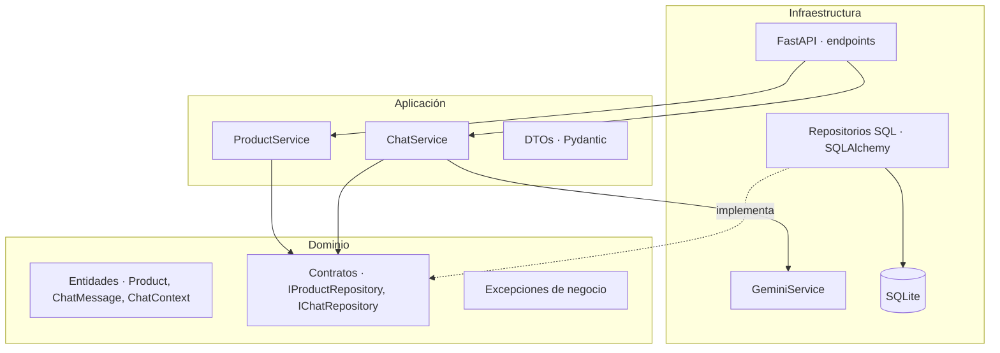
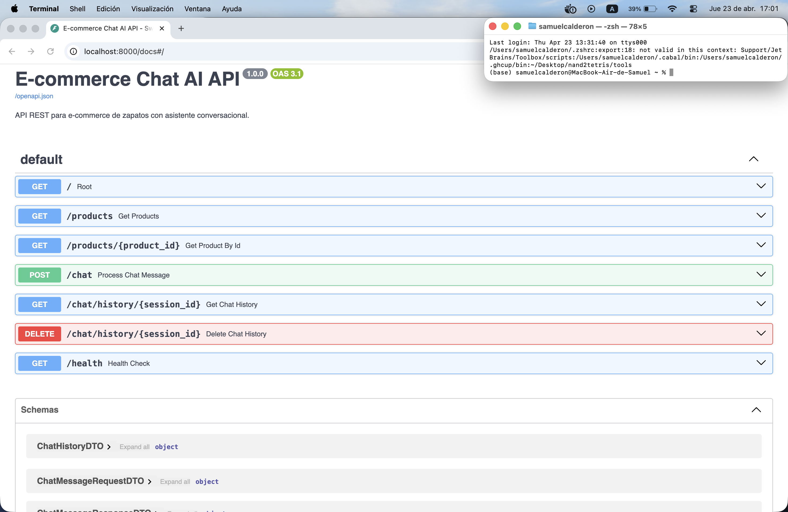
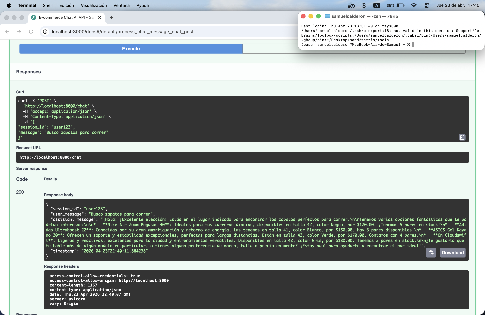
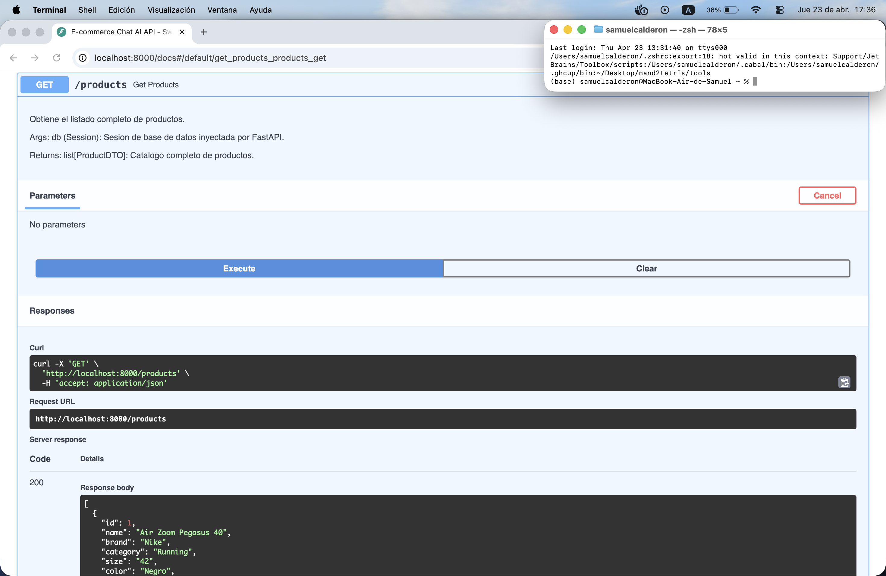
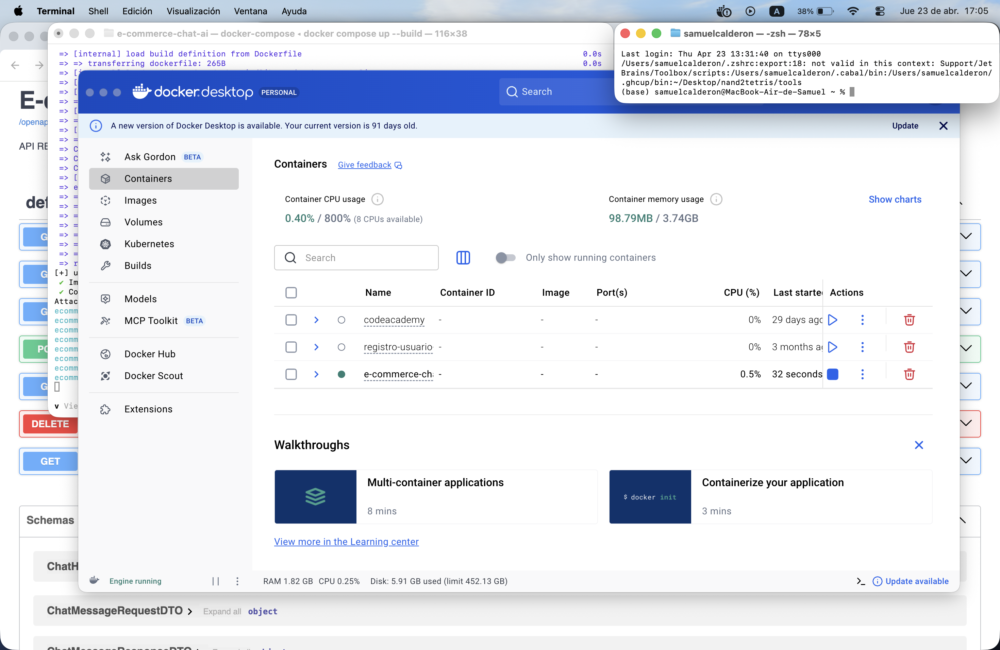

# E-commerce con Chat Inteligente

API REST para una tienda de zapatos con un **asistente de ventas conversacional** basado en Google Gemini. El asistente conoce el catálogo (precio, talla, color y stock), recuerda la conversación de cada sesión y recomienda productos concretos.

Está construida con **FastAPI** siguiendo **Clean Architecture**: la lógica de negocio no depende del framework web, la base de datos ni el proveedor de IA.

Proyecto individual, Universidad EAFIT (2026-1).

## Funcionalidades

- **Catálogo:** listar productos y consultar un producto por ID.
- **Chat con IA:** el asistente recibe el catálogo y los últimos 6 mensajes de la sesión como contexto, y responde con recomendaciones específicas.
- **Memoria por sesión:** cada conversación se guarda con su `session_id`; se puede consultar o borrar el historial.
- **Validaciones de dominio:** las entidades rechazan datos inválidos (precio ≤ 0, stock negativo, nombre vacío, roles de mensaje desconocidos).
- **Datos semilla:** al arrancar se crean las tablas y un catálogo de 10 productos de ejemplo.
- **Documentación automática** con Swagger UI y health check para Docker.

## Arquitectura



| Capa | Contenido | Depende de |
|---|---|---|
| **Dominio** (`src/domain`) | Entidades con reglas de negocio, contratos de repositorio (interfaces) y excepciones | Nada |
| **Aplicación** (`src/application`) | Casos de uso (`ProductService`, `ChatService`) y DTOs | Dominio |
| **Infraestructura** (`src/infrastructure`) | API FastAPI, modelos ORM, repositorios SQL y cliente de Gemini | Aplicación y dominio |

Los servicios reciben sus repositorios y el proveedor de IA por inyección de dependencias. Por eso la base de datos o el modelo se pueden cambiar sin tocar la lógica, y las pruebas pueden usar dobles en lugar de servicios reales.

**Flujo de un mensaje de chat**

1. `POST /chat` recibe `session_id` y `message`.
2. `ChatService` obtiene el catálogo y los últimos 6 mensajes de la sesión.
3. `GeminiService` arma el prompt (rol de asesor, productos disponibles, historial e instrucciones) y llama a `gemini-2.5-flash`.
4. Se guardan el mensaje del usuario y la respuesta del asistente, y se devuelve la respuesta.

## Endpoints

| Método | Ruta | Descripción |
|---|---|---|
| `GET` | `/products` | Lista todo el catálogo |
| `GET` | `/products/{id}` | Detalle de un producto |
| `POST` | `/chat` | Envía un mensaje al asistente y recibe la respuesta |
| `GET` | `/chat/history/{session_id}` | Historial de una sesión |
| `DELETE` | `/chat/history/{session_id}` | Borra el historial de una sesión |
| `GET` | `/health` | Estado del servicio |

Ejemplo:

```bash
curl -X POST http://localhost:8000/chat \
  -H "Content-Type: application/json" \
  -d '{"session_id": "user123", "message": "Busco zapatos para correr, talla 42"}'
```

## Tecnologías

Python 3.11 · FastAPI · Uvicorn · SQLAlchemy 2 · Pydantic 2 · SQLite · Google Gemini (`google-generativeai`) · Docker y Docker Compose · pytest

## Cómo ejecutarlo

Necesitas una API key de Gemini ([Google AI Studio](https://aistudio.google.com/app/apikey)). El código está en la carpeta `e-commerce-chat-ai/`.

```bash
git clone https://github.com/sscalderod/E-Commerce-con-Chat-Inteligente.git
cd E-Commerce-con-Chat-Inteligente/e-commerce-chat-ai
cp .env.example .env        # y pon tu GEMINI_API_KEY
```

**Con Docker (recomendado)**

```bash
docker compose up --build
```

**En local**

```bash
python3 -m venv venv
source venv/bin/activate
pip install -r requirements.txt
uvicorn src.infrastructure.api.main:app --reload
```

La API queda en http://localhost:8000 y la documentación interactiva en http://localhost:8000/docs. La base de datos se crea sola en `data/ecommerce_chat.db`; para reiniciar los datos, borra ese archivo.

**Variables de entorno**

| Variable | Ejemplo |
|---|---|
| `GEMINI_API_KEY` | tu API key |
| `DATABASE_URL` | `sqlite:///./data/ecommerce_chat.db` |
| `ENVIRONMENT` | `development` |

## Pruebas

19 pruebas unitarias con pytest: reglas de las entidades de dominio y casos de uso de los servicios.

```bash
pytest -q
```

## Capturas

| Swagger UI | Chat con el asistente |
|---|---|
|  |  |

| Catálogo | Contenedor en Docker |
|---|---|
|  |  |

## Estructura

```
e-commerce-chat-ai/
├── src/
│   ├── domain/            entidades, contratos de repositorio y excepciones
│   ├── application/       servicios (casos de uso) y DTOs
│   └── infrastructure/
│       ├── api/           aplicación FastAPI y endpoints
│       ├── db/            conexión, modelos ORM y datos semilla
│       ├── repositories/  implementaciones SQL de los contratos
│       └── llm_providers/ integración con Gemini
├── tests/                 pruebas unitarias
├── evidencias/            capturas
├── Dockerfile
└── docker-compose.yml
```

## Posibles mejoras

- Exponer en la API la búsqueda por marca y categoría, que ya existe en la capa de servicios.
- Agregar endpoints de administración del catálogo (crear, editar y eliminar), también implementados en `ProductService`.
- Pruebas de integración de los endpoints con `TestClient` y un proveedor de IA simulado.

## Autor

**Samuel Calderón Duque**: [GitHub](https://github.com/sscalderod) · [LinkedIn](https://www.linkedin.com/in/samuel-calderon-duque-b8772b37a/)
